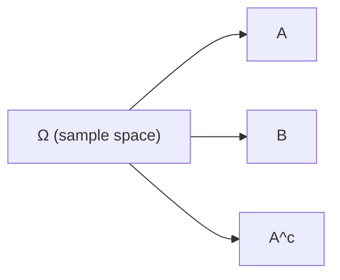

# M0.1 Sets and Event Language / 集合与事件语言

**Prerequisites / 前置**: None

---

## Content / 内容

A set is a collection of elements. In probability we use sets to describe events. The sample space Ω is the set of all possible outcomes. An event A is a subset of Ω (A ⊆ Ω). The empty set ∅ contains nothing; the universal set is Ω itself.

集合是元素的汇集。在概率中我们用集合描述事件。样本空间 Ω 是所有可能结果的集合。事件 A 是 Ω 的子集（A ⊆ Ω）。空集 ∅ 不含任何元素；全集就是 Ω 本身。

Basic operations: intersection A ∩ B (elements in both), union A ∪ B (elements in at least one), complement A^c (elements in Ω but not in A). Subset relation A ⊆ B means every element of A is also in B.

基本运算：交集 A ∩ B（同时属于两者的元素），并集 A ∪ B（至少属于其中一个的元素），补集 A^c（属于 Ω 但不属于 A 的元素）。子集关系 A ⊆ B 表示 A 的每个元素也属于 B。

Two events are mutually exclusive (disjoint) if A ∩ B = ∅. A collection of events is exhaustive if their union equals Ω. De Morgan’s laws: (A ∪ B)^c = A^c ∩ B^c and (A ∩ B)^c = A^c ∪ B^c.

两个事件互斥（不相交）当且仅当 A ∩ B = ∅。一组事件穷尽当且仅当它们的并等于 Ω。De Morgan 律：(A ∪ B)^c = A^c ∩ B^c，(A ∩ B)^c = A^c ∪ B^c。

Translate everyday language into set operations: “at least one” → union; “exactly one” → (A ∩ B^c) ∪ (A^c ∩ B); “neither” → A^c ∩ B^c; “at least two” among three → pairs of intersections; “all” → full intersection.

把日常语言翻译成集合运算：“至少一个”→ 并；“恰好一个”→ (A ∩ B^c) ∪ (A^c ∩ B)；“都不”→ A^c ∩ B^c；三个事件中“至少两个”→ 两两交的并；“全部”→ 全交。

## Example / 例子

Let Ω = {1,2,3,4,5,6} (fair die). Let A = {even} = {2,4,6}, B = {>3} = {4,5,6}. Then A ∩ B = {4,6}, A ∪ B = {2,4,5,6}, A^c = {1,3,5}, (A ∪ B)^c = {1,3}.

设 Ω = {1,2,3,4,5,6}（公平骰子）。设 A = {偶数} = {2,4,6}，B = {>3} = {4,5,6}。则 A ∩ B = {4,6}，A ∪ B = {2,4,5,6}，A^c = {1,3,5}，(A ∪ B)^c = {1,3}。

## Practice Problem / 练习题

Three events A, B, C. Express in set notation: (1) at least one occurs; (2) exactly two occur; (3) none occur. Write the corresponding De Morgan form for “none occur”.

三个事件 A, B, C。用集合记号表示：(1) 至少一个发生；(2) 恰好两个发生；(3) 都不发生。写出“都不发生”的 De Morgan 形式。

Solution sketch / 解答提示

(1) A ∪ B ∪ C

(2) (A ∩ B ∩ C^c) ∪ (A ∩ B^c ∩ C) ∪ (A^c ∩ B ∩ C)

(3) A^c ∩ B^c ∩ C^c = (A ∪ B ∪ C)^c

---

**Next / 后置**: [M0.2 Counting Principles](M0.2.md), [M1.1 Sample Space and Axioms](M1.1.md)
