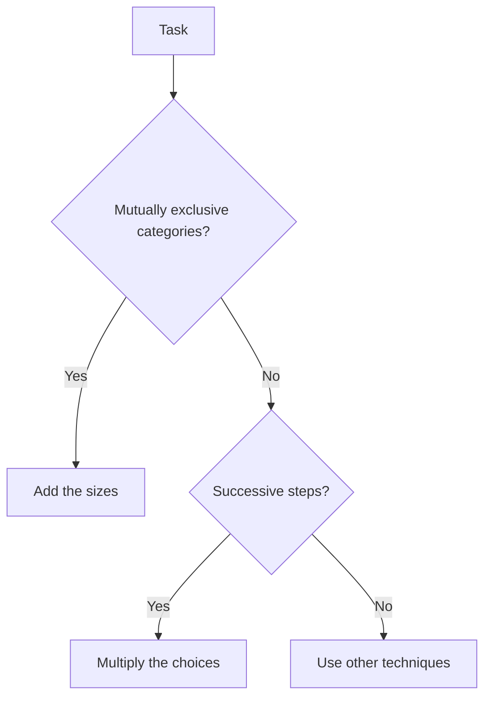

# M0.2 Two Fundamental Counting Principles / 计数两大原理

**Prerequisites / 前置**: [M0.1 Sets and Event Language](M0.1.md)

---

## Content / 内容

The addition principle: if a task can be done in mutually exclusive ways (categories), the total number of ways is the sum of the numbers in each category. The categories must be disjoint; otherwise you overcount.

加法原理：若一项任务可按互斥方式（类别）完成，则总方法数是各类方法数之和。类别必须互斥，否则会重复计数。

The multiplication principle: if a task is completed in successive steps and the number of choices at each step does not depend on previous choices (or is constant after conditioning), the total is the product of the numbers of choices at each step.

乘法原理：若一项任务分步完成，且每步的选择数不依赖前面的选择（或条件固定后为常数），则总数是各步选择数的乘积。

Before counting, decide four attributes: ordered vs unordered, with replacement vs without replacement, distinguishable objects vs indistinguishable, empty boxes/classes allowed or not. Wrong answers almost always come from a wrong decision on one of these four.

计数前先判断四个属性：有序还是无序、有放回还是无放回、对象可区分还是不可区分、是否允许空盒/空类。错误答案几乎总是这四个判断中至少一个出错。

## Example / 例子

A restaurant offers 3 soups and 4 main courses. Number of soup-then-main meals: 3 × 4 = 12 (multiplication). Number of ways to choose either a soup or a main (not both): 3 + 4 = 7 (addition). Number of ways to choose one soup and one main: still 12.

一家餐厅有 3 种汤和 4 种主菜。先汤后主菜的套餐数：3 × 4 = 12（乘法）。只选汤或只选主菜（不都选）：3 + 4 = 7（加法）。同时选一汤一主：仍是 12。

## Practice Problem / 练习题

A code consists of two letters followed by two digits. Letters may repeat, digits may not. How many codes? (Assume 26 letters, digits 0-9.)

一个密码由两个字母后跟两个数字组成。字母可重复，数字不可重复。有多少种密码？（假设 26 个字母，数字 0-9。）

Solution sketch / 解答提示

Letters: 26 × 26. Digits: 10 × 9. Total: 26 × 26 × 10 × 9.

字母：26 × 26。数字：10 × 9。总数：26 × 26 × 10 × 9。

---

**Next / 后置**: [M0.3 Factorials, Permutations, Combinations](M0.3.md)
