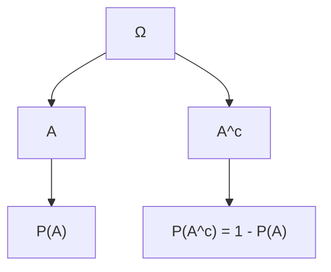

# M1.1 Sample Space, Events, Probability Axioms / 样本空间、事件、概率公理

**Prerequisites / 前置**: [M0.1 Sets and Event Language](M0.1.md)

---

## Content / 内容

The sample space Ω is the set of all possible outcomes of an experiment. An event is any subset A ⊆ Ω. Probability is a function P that assigns to each event a number satisfying three axioms: (1) 0 ≤ P(A) ≤ 1 for every event A; (2) P(Ω) = 1; (3) countable additivity — if A1, A2, … are pairwise disjoint then P(∪ Ai) = Σ P(Ai). In particular P(∅) = 0.

样本空间 Ω 是试验所有可能结果的集合。事件是任意子集 A ⊆ Ω。概率是满足三条公理的函数 P：(1) 对每个事件 A 有 0 ≤ P(A) ≤ 1；(2) P(Ω) = 1；(3) 可列可加性——若 A1, A2, … 两两互斥，则 P(∪ Ai) = Σ P(Ai)。特别地 P(∅) = 0。

When the sample space is finite and every outcome is equally likely (classical probability model), P(A) equals the number of outcomes in A divided by the total number of outcomes |
Ω|. This requires a carefully defined sample space in which outcomes are equally likely.

当样本空间有限且每个结果等可能（古典概型）时，P(A) 等于 A 中结果数除以总结果数 |Ω|。这要求样本空间定义得当，使结果确实等可能。

## Example / 例子

Fair six-sided die. Ω = {1,2,3,4,5,6}, each outcome has probability 1/6. Event “even” A = {2,4,6}, P(A) = 3/6 = 1/2. Event “greater than 4” B = {5,6}, P(B) = 2/6 = 1/3. A and B are not disjoint; A ∩ B = {6}.

公平六面骰。Ω = {1,2,3,4,5,6}，每个结果概率 1/6。事件“偶数”A = {2,4,6}，P(A) = 3/6 = 1/2。事件“大于 4”B = {5,6}，P(B) = 2/6 = 1/3。A 与 B 不互斥；A ∩ B = {6}。

## Practice Problem / 练习题

A fair coin is tossed twice. List Ω. Let A = “at least one head”, B = “two heads”. Find P(A), P(B), P(A ∩ B), P(A ∪ B).

公平硬币抛两次。列出 Ω。设 A = “至少一次正面”，B = “两次正面”。求 P(A), P(B), P(A ∩ B), P(A ∪ B)。

Solution sketch / 解答提示

Ω = {HH, HT, TH, TT}, each 1/4. A = {HH, HT, TH}, P(A)=3/4. B={HH}, P(B)=1/4. A ∩ B = B, P=1/4. A ∪ B = A, P=3/4.

Ω = {HH, HT, TH, TT}，各 1/4。A = {HH, HT, TH}，P(A)=3/4。B={HH}，P(B)=1/4。A ∩ B = B，P=1/4。A ∪ B = A，P=3/4。

---

**Next / 后置**: [M1.2 Complement, Union, Inclusion-Exclusion](M1.2.md), [M1.3 Conditional Probability](M1.3.md), [M1.8 Random Variables, PMF, CDF](M1.8.md)
